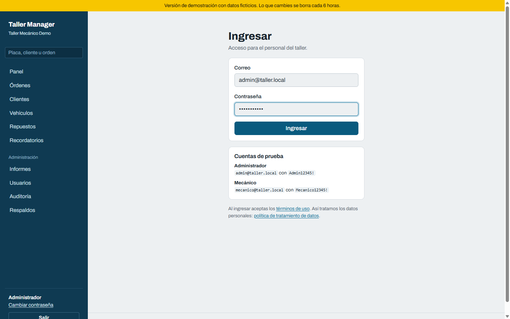
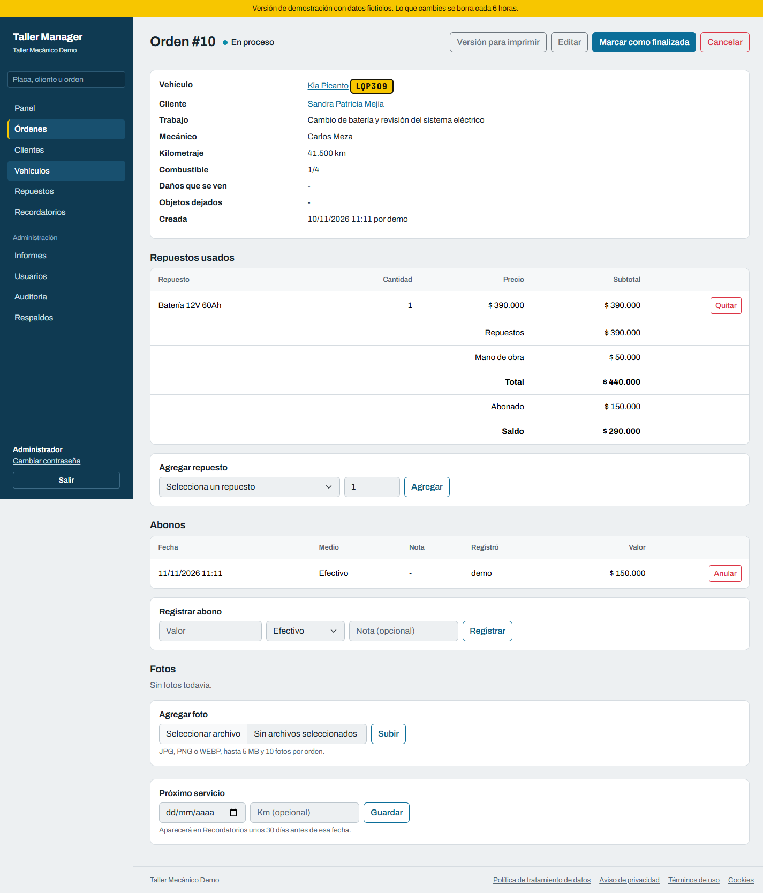
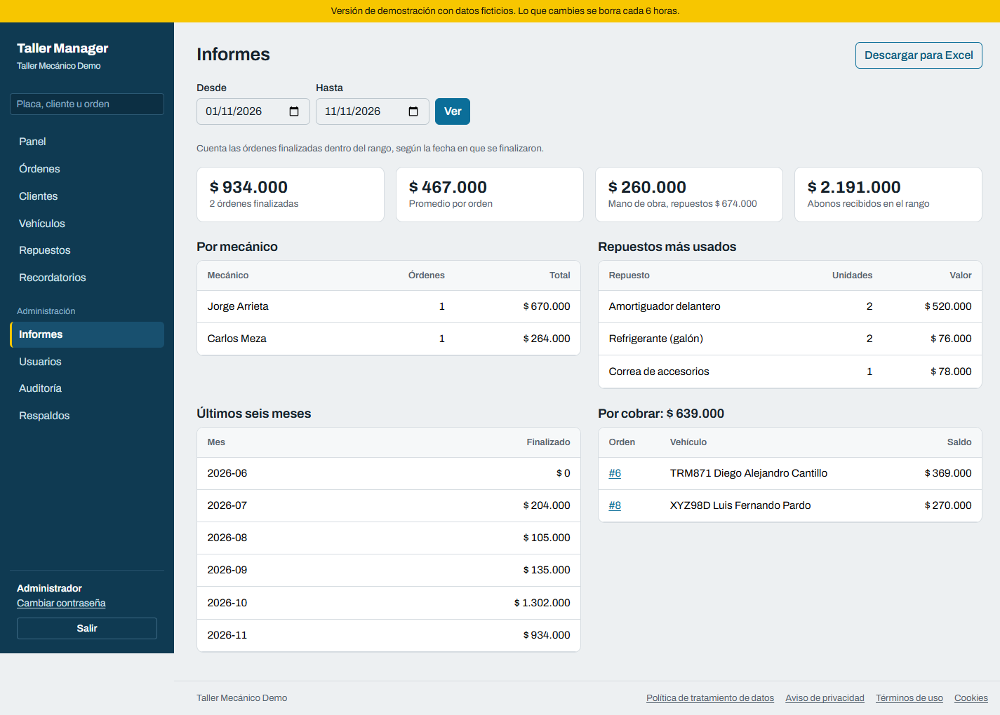
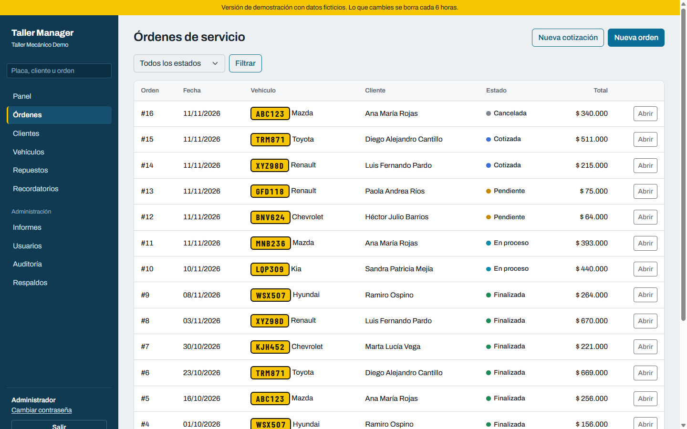
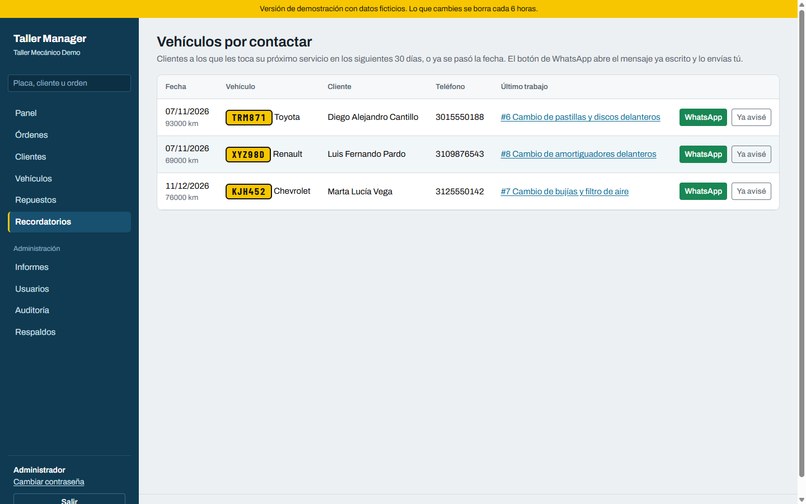
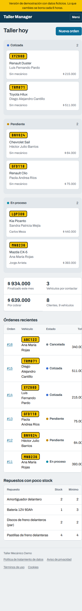

# Taller Manager

Aplicación web para llevar un taller mecánico: clientes, vehículos, repuestos y órdenes de servicio. Está hecha con Spring Boot 3, Spring Data JPA, Thymeleaf y Spring Security, y pensada para funcionar en Colombia (pesos colombianos, hora de Bogotá, Ley 1581 de 2012).

Lo hice como proyecto de portafolio. Los datos que verás en las capturas son inventados.



| | |
|---|---|
|  |  |
|  |  |

En el celular el menú lateral se pliega y el tablero pasa a una sola columna:



## Tecnologías

Java 17, Spring Boot 3.2, Spring Data JPA con Hibernate, Spring Security 6, Thymeleaf, Flyway, MySQL 8 (H2 para la demostración), Bootstrap 5 y JUnit 5. Las tipografías (Archivo y Barlow Condensed) vienen dentro del proyecto con su licencia.

## Qué hace

- Clientes con búsqueda y paginación. Al crear uno se exige la autorización de tratamiento de datos y queda guardada la fecha, la versión de la política y quién la registró.
- Vehículos ligados a un cliente, con validación de placa colombiana (ABC123 o ABC12D).
- Repuestos con stock, stock mínimo y precio. El stock se descuenta con una sola instrucción SQL, así que dos órdenes al mismo tiempo no lo dejan en negativo.
- Órdenes de servicio: cotizada, pendiente, en proceso, finalizada o cancelada. Cancelar o quitar un repuesto devuelve las unidades al stock. El precio de cada repuesto queda congelado en la orden.
- Cotizaciones: se abren igual que una orden, el cliente la aprueba y pasa a pendiente. Los repuestos quedan reservados mientras tanto. La hoja impresa trae la vigencia (8 días por defecto, se cambia con `TALLER_COTIZACION_DIAS`) y espacio para la firma.
- Recepción del vehículo: nivel de combustible, daños que se ven, objetos que quedan dentro y hasta 10 fotos por orden (JPG, PNG o WEBP, 5 MB cada una).
- Mecánico asignado a cada orden y registro de abonos con medio de pago. El saldo se calcula solo, y el abono no puede pasar de lo que falta.
- Recordatorios: al terminar una orden se programa la fecha del próximo servicio y el vehículo aparece en la lista de contactar 30 días antes. Los botones de WhatsApp abren el mensaje ya escrito para que lo envíes tú; el sistema no manda nada por su cuenta y solo los muestra si el cliente autorizó el tratamiento de datos y tiene un celular colombiano válido.
- Informes (solo administrador): facturado por rango de fechas, promedio por orden, por mecánico, repuestos más usados, últimos seis meses y saldos por cobrar. Descarga en CSV listo para Excel.
- Versión de la orden para imprimir.
- Panel con órdenes abiertas, lo finalizado en el mes, cotizaciones sin aprobar, vehículos por contactar y repuestos por agotarse.
- Usuarios con dos roles: administrador y mecánico. Auditoría de las acciones importantes.
- Búsqueda global en el menú lateral: placa, nombre, documento, teléfono o número de orden.
- Respaldos (solo administrador, menú Respaldos): cada noche a las 2:00 a. m. se guarda un zip con todas las tablas en CSV y las fotos. Se conservan los últimos 14 (`TALLER_RESPALDOS_CONSERVAR`), en `datos/respaldos` (`TALLER_RESPALDOS_DIR`). Es una copia de los datos, no un volcado de MySQL: para restaurar la base completa conviene además usar `mysqldump`. Las claves de los usuarios no se incluyen.
- Páginas legales: política de tratamiento de datos, aviso de privacidad, términos de uso y cookies.

## Probar la demostración

Necesitas JDK 17 o superior y Maven. No hace falta instalar MySQL.

```
mvn spring-boot:run -Dspring-boot.run.profiles=demo
```

Abre http://localhost:8080. La pantalla de ingreso muestra las cuentas de prueba: `admin@taller.local` con `Admin12345!` y `mecanico@taller.local` con `Mecanico12345!`.

El perfil `demo` usa una base H2 en memoria con 8 clientes, 9 vehículos, 12 repuestos y 16 órdenes en todos los estados, con abonos y próximos servicios. Cada 6 horas borra lo que hayan creado los visitantes y vuelve a cargar los datos de ejemplo (se cambia con `taller.demo.reinicio-horas`). Muestra un aviso amarillo arriba y las claves de prueba en el login. No lo uses con datos reales.

Con Docker, sin instalar nada más:

```
docker build -t taller-manager .
docker run -p 8080:8080 -e SPRING_PROFILES_ACTIVE=demo taller-manager
```

También existe el perfil `dev`, igual pero sin reinicio automático y con pocos datos (`-Dspring-boot.run.profiles=dev`).

## Correrlo con MySQL

1. Crea la base: `mysql -u root -p < database/crear_base.sql`. El archivo también explica cómo crear un usuario propio en vez de usar root.
2. Define las variables de entorno (ver la tabla de abajo).
3. Ejecuta `mvn spring-boot:run`.

Flyway crea las tablas la primera vez. No hace falta correr ningún script más.

## Con Docker

```
cp .env.example .env
```

Edita `.env` con tus claves y los datos del taller, y luego:

```
docker compose up -d --build
```

La aplicación queda en el puerto 8080 y los datos de MySQL en un volumen llamado `datos_mysql`.

## Variables de entorno

| Variable | Para qué sirve | Valor por defecto |
|---|---|---|
| DB_URL | URL JDBC de MySQL | localhost:3306/taller_manager |
| DB_USER, DB_PASSWORD | Usuario y clave de la base | ver application.properties |
| ADMIN_EMAIL, ADMIN_PASSWORD | Primer administrador, solo si no hay usuarios | admin@taller.local y una clave aleatoria que se imprime una vez en el log |
| SESSION_COOKIE_SECURE | Poner en true cuando uses HTTPS | false |
| TALLER_NOMBRE, TALLER_NIT, TALLER_DIRECCION, TALLER_CIUDAD, TALLER_EMAIL, TALLER_TELEFONO | Datos del responsable que salen en las páginas legales y en la orden impresa | "sin configurar" |
| TALLER_COTIZACION_DIAS | Días de validez impresos en las cotizaciones | 8 |
| TALLER_FOTOS_DIR | Carpeta donde se guardan las fotos de recepción | datos/fotos |
| TALLER_RESPALDOS_DIR | Carpeta de los respaldos automáticos | datos/respaldos |
| TALLER_RESPALDOS_CONSERVAR | Cuántos respaldos se guardan | 14 |
| TALLER_RESPALDOS_CRON | Cuándo se hace el respaldo diario (cron de Spring) | 0 0 2 * * * |
| PORT | Puerto HTTP | 8080 |

Si no defines `ADMIN_PASSWORD`, busca en el log de arranque la línea con la clave generada y cámbiala en cuanto entres.

## Seguridad

- Contraseñas con BCrypt, mínimo 10 caracteres con letras y números.
- La cuenta se bloquea 15 minutos después de 5 intentos fallidos. El mensaje de error del login es el mismo si el correo no existe o la clave está mal.
- Protección CSRF en todos los formularios.
- Política de contenido estricta: Bootstrap viene incluido en `static/vendor`, no se carga nada de servidores externos y no hay scripts en línea. Si agregas JavaScript, ponlo en `static/js/app.js`.
- Los errores no muestran trazas ni detalles internos.
- Solo los administradores gestionan usuarios, ven la auditoría y los informes, ajustan stock, eliminan vehículos, anulan abonos, borran fotos y atienden solicitudes de acceso o supresión de datos.
- Las fotos se guardan con nombre aleatorio fuera de la carpeta pública, solo se entregan a usuarios con sesión, y se comprueba que el archivo sea de verdad una imagen y no solo que tenga la extensión.

Pon la aplicación detrás de HTTPS (Nginx, Caddy o el proxy de tu proveedor) y activa `SESSION_COOKIE_SECURE=true`. Sin HTTPS, las claves viajan en texto plano.

## Copias de seguridad

La aplicación guarda sola un respaldo cada noche (ver arriba). Es una copia de los datos en CSV, útil para recuperar información, pero no reemplaza un volcado de la base. Haz además una copia de la base todos los días y pruébala restaurando de vez en cuando. Las fotos no están en la base: viven en la carpeta `TALLER_FOTOS_DIR` (en Docker, el volumen `datos_fotos`), así que esa carpeta también debe entrar en el respaldo.

```
mysqldump -u taller -p --single-transaction taller_manager > respaldo-$(date +%F).sql
```

Con Docker: `docker compose exec db mysqldump -u root -p taller_manager > respaldo.sql`.

## Antes de usarlo con clientes reales

Esto no es asesoría legal. Lo que sigue es una lista de cosas que conviene revisar con un abogado o con quien lleve tu cumplimiento:

- Lee las cuatro páginas de `templates/legal` y ajústalas a cómo trabaja tu taller. Los plazos de respuesta a consultas (10 días hábiles, prorrogables 5) y reclamos (15 días hábiles, prorrogables 8) vienen de la Ley 1581 de 2012; confírmalos con tu asesor.
- Llena los datos del responsable con las variables `TALLER_*`. Sin eso, las páginas legales dicen "sin configurar".
- Designa a la persona o área que atenderá las solicitudes de los titulares y asegúrate de que el correo `TALLER_EMAIL` lo lee alguien.
- El Registro Nacional de Bases de Datos (RNBD) solo es obligatorio para responsables con activos totales superiores a 100.000 UVT. Verifica si es tu caso.
- La orden de servicio no es una factura. Si vendes repuestos o servicios debes facturar con la facturación electrónica de la DIAN, que este sistema no hace.
- Las fotos de los vehículos pueden mostrar placas o personas. La política ya dice que se toman al recibir el carro; si cambias el uso, actualízala.
- Si algún día recoges datos de menores o datos sensibles, hay que cambiar el diseño y la política.
- La garantía de los trabajos se rige por la Ley 1480 de 2011. La orden impresa lo menciona de forma general; si ofreces condiciones propias, escríbelas en un lugar visible.

## Estructura

```
src/main/java/com/taller
  config/       seguridad, propiedades, datos iniciales y de demostración
  model/        entidades JPA
  repository/   consultas con Spring Data
  service/      reglas de negocio y transacciones
  web/          controladores y formularios
src/main/resources
  db/migration/ esquema de la base (Flyway)
  templates/    vistas Thymeleaf
  static/       CSS, JS y Bootstrap
```

## Pruebas

```
mvn test
```

Son 19 pruebas. Las unitarias cubren el modelo (totales de la orden, aprobación de cotizaciones, stock, anonimización del cliente), los números de WhatsApp y la política de contraseñas. Las de integración levantan la aplicación completa con el perfil `demo` y comprueban que los datos de ejemplo cargan en todos los estados, que el respaldo trae todas las tablas y no incluye las claves, que solo se pueden descargar respaldos con nombre válido y que el reinicio de la demostración deja todo como al principio.

Todavía faltan pruebas de los controladores y de los permisos por rol.

## Qué le falta

- Facturación electrónica con la DIAN, que se haría a través de un proveedor autorizado.
- Agenda de citas.
- Que el cliente consulte el estado de su orden con un enlace.
- Compras a proveedores y entrada de repuestos al stock.

## Licencia

MIT. Ver el archivo LICENSE.
